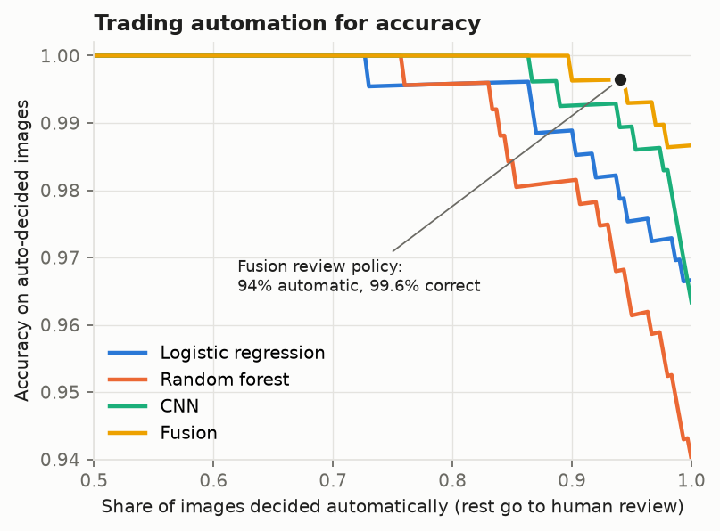
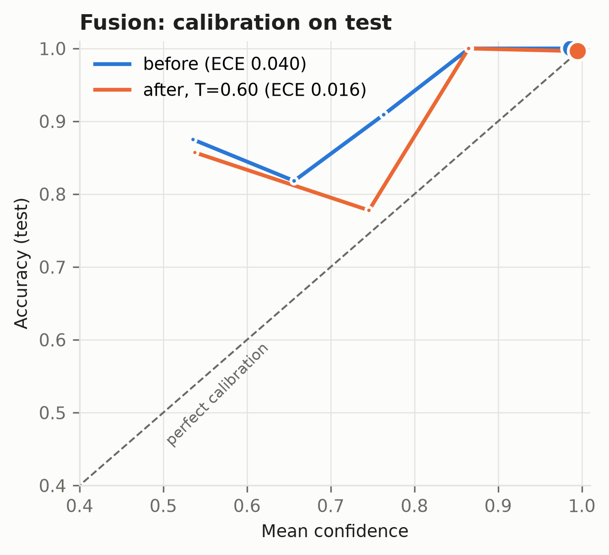
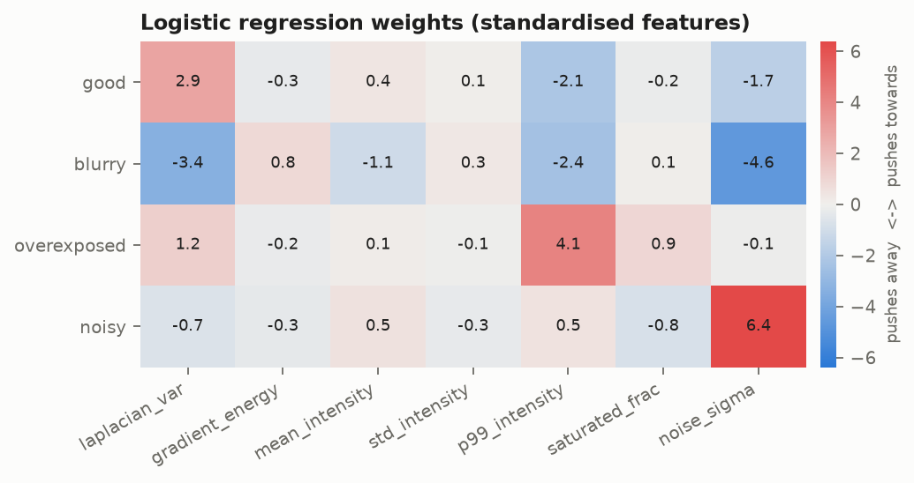
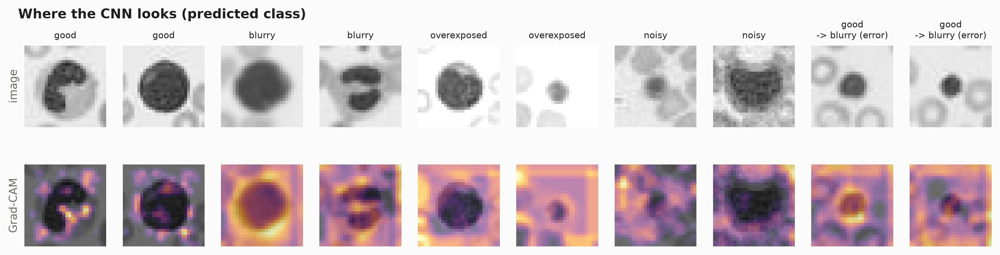
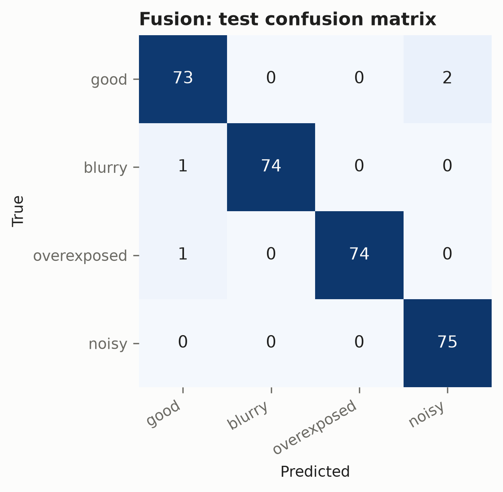

# microscopy-qc

Reproducible, explainable quality control (QC) for microscopy images.

> **Status:** work in progress, Phase 5 of 7 (calibration, human review, explainability).

## Problem

Microscopy images taken in the lab are sometimes out of focus, overexposed or
noisy. If those images go unnoticed into downstream analysis, results become
unreliable and hard to reproduce. This project builds a small, transparent
system that flags low-quality images and explains *why* each one was flagged.

## Approach (planned)

1. Take public cell images (MedMNIST) and apply **controlled, seeded
   degradations** (blur, exposure shift, noise), so the true QC label is known.
2. Compare three models:
   - interpretable QC features (sharpness, exposure, SNR) + a classical classifier
   - a small CNN on the raw image
   - a fusion of both
3. Report calibrated confidence and send low-confidence images to human review.
4. Explain decisions with feature importance and Grad-CAM.

## Quickstart

```bash
python -m venv .venv
source .venv/bin/activate        # Windows: .venv\Scripts\activate
make install
make test
make data      # downloads BloodMNIST and builds the QC dataset
make train     # trains all 4 models (~1 min on a laptop CPU); results in runs/<timestamp>/
make report    # calibration, review policy and figures for the latest run
# or simply: make all
```

## Reproducibility

- All settings live in `configs/`; nothing is hard-coded.
- One seed in the config controls all randomness.
- Dependencies are pinned to exact versions in `pyproject.toml`.
- The source data is verified against its published MD5 checksum before use.
- Every generated dataset is saved with a metadata JSON (config, seed, source
  checksum, split sizes, creation time), so any result can be traced back to
  exactly how its data was made.
- Each degraded image stores its severity, so errors can be analysed by how
  strong the degradation was.
- `mqc report` refuses to run if the dataset's checksum differs from the one
  recorded at training time.

## Data

Source images: [MedMNIST v3](https://medmnist.com) BloodMNIST (CC BY 4.0),
28x28 images of blood cells, converted to grayscale. Only the official
training split is used as a pool; 2,000 images are sampled (500 per class)
and each is used once:

| QC class      | Simulates                      | Severity drawn from        |
|---------------|--------------------------------|----------------------------|
| `good`        | unchanged image                | -                          |
| `blurry`      | out-of-focus acquisition       | Gaussian sigma 0.4-1.0 px  |
| `overexposed` | too-long exposure / high gain  | brightness x1.05-1.3, clip |
| `noisy`       | low light / sensor noise       | Gaussian noise std 0.01-0.05 |

The data is then split 70/15/15 into train/val/test, stratified by class.

**Why such mild degradations?** A first version used stronger settings
(blur 0.8-2.0, gain 1.5-2.5, noise 0.05-0.15). A simple logistic regression
on the features below reached 99-100% test accuracy, which says more about the
benchmark than the model. Subtle failures are also the ones most likely to slip
past a person at the microscope, so the ranges were reduced until the task was
no longer trivial.

## QC features

Each feature mirrors something a scientist would check by eye:

| Feature | Measures |
|---|---|
| `laplacian_var` | sharpness (variance of the Laplacian) |
| `gradient_energy` | sharpness (mean squared Sobel gradient) |
| `mean_intensity`, `std_intensity` | brightness and contrast |
| `p99_intensity`, `saturated_frac` | highlights and clipped pixels |
| `noise_sigma` | noise level, Immerkaer (1996) fast noise estimator |

Two classical models use them: logistic regression (weights are directly
readable) and a random forest.

## Neural models

- **`cnn`**: a small CNN (4 conv layers, ~17k parameters) on the raw image.
  The first two layers keep full resolution because blur and noise live in fine
  detail. Images are not normalised per image, since brightness is itself the
  signal for overexposure.
- **`fusion`**: the CNN's image embedding concatenated with the 7 standardised
  QC features, then a small MLP. Feature scaling uses training data only.

Both are trained with Adam and early stopping on validation loss. The training
loop is written out explicitly in `src/mqc/torch_train.py`.

## Results

Test set: 300 images (75 per class). 95% confidence intervals from 2,000
bootstrap resamples.

| Model | Val acc | Test acc | Test 95% CI | Test macro-F1 |
|---|---|---|---|---|
| Logistic regression (features) | 0.963 | 0.967 | 0.943-0.987 | 0.967 |
| Random forest (features) | 0.980 | 0.940 | 0.910-0.967 | 0.940 |
| CNN (pixels) | 0.967 | 0.963 | 0.940-0.983 | 0.964 |
| **Fusion (pixels + features)** | 0.973 | **0.980** | 0.963-0.993 | 0.980 |

Test recall on the **mildest third** of each degradation (medium and severe
cases are 100% for all models):

| Model | Blurry | Overexposed | Noisy |
|---|---|---|---|
| Logistic regression | **0.88** | 0.96 | 0.80 |
| CNN | 0.72 | 0.96 | 0.96 |
| Fusion | 0.84 | 0.96 | **1.00** |

What this shows:

- Every error is a mildly degraded image predicted as `good`; no degradation
  type is ever confused with another.
- The hand-made sharpness features catch mild blur better than the CNN; the CNN
  catches mild noise better than the features. Fusion combines both strengths.
- The random forest's 4-point drop from validation to test is a warning sign
  of overfitting; the simpler logistic regression generalises better.
- The confidence intervals overlap, so with 300 test images the ranking of
  the top models is suggestive rather than conclusive.

## From prediction to decision support

A QC tool in a lab should not just output a label. It should say how sure it
is, and hand uncertain images to a person. `make report` does this for every
model, using only validation data to make choices and test data to report.

1. **Calibration.** A temperature T is fitted on validation log-loss and
   applied unchanged to test. Expected calibration error (ECE) is reported
   before and after. All four models came out slightly *under*-confident
   (T < 1), which is typical after weight decay and early stopping.
2. **Human-review policy.** On validation, the lowest confidence threshold
   whose automatically decided images reach **99% accuracy** is chosen. Images
   below it are flagged for a person. The model that automates the most on
   validation is recommended; its test result is reported, not used to choose.

| Model | Auto-decided (test) | Accuracy when auto-decided | Errors sent to review |
|---|---|---|---|
| Logistic regression | 89.7% | 98.9% | 7 of 10 |
| Random forest | 85.3% | 98.0% | 13 of 18 |
| CNN | 95.3% | 99.0% | 8 of 11 |
| **Fusion (recommended)** | 93.0% | **99.3%** | 4 of 6 |





## Explainability

**Feature model.** Logistic-regression weights read like a lab checklist:
high `noise_sigma` pushes towards *noisy*, high `p99_intensity` towards
*overexposed*, high `laplacian_var` (sharpness) towards *good*.



**CNN (Grad-CAM).** For *blurry* images the network attends to cell edges,
where focus loss is visible. For *overexposed* and *noisy* images it attends to
the background, where saturation and noise are easiest to see against a flat
area.





**Reproducibility check.** The scikit-learn results above were produced
independently on macOS (Apple Silicon) and Linux (x86-64) from the same commit
and dataset checksum and matched to every reported digit. Two consecutive runs
on the same machine give byte-identical `summary.json` for all four models.
Neural-network results may differ in the last decimals across hardware.

## Run outputs

Every `make train` creates `runs/<UTC timestamp>/` containing:

- `config.yaml`: the exact settings used
- `provenance.json`: git commit (and whether the code had uncommitted
  changes), dataset MD5, Python and package versions
- `summary.json`: accuracy and macro-F1 per model
- `<model>/metrics.json`: per-class precision/recall, confusion matrix,
  recall by degradation severity (mild / medium / severe), feature importance
- `<model>/model.joblib`: the trained model

Models are trained on `train` only. Hyperparameters are fixed in the config,
not tuned on the test set.

## Project layout

```
configs/   experiment settings
src/mqc/   package source code
tests/     automated tests
data/      downloaded data (not committed)
reports/   figures and model card
docs/      design notes
```

## License

MIT
